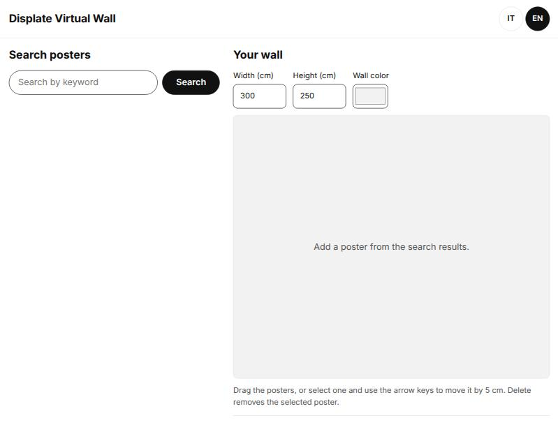

# Displate Virtual Wall

Search Displate posters, pick each one in a size (M, L or XL) and arrange them on a virtual wall at real
scale, to see how they match before buying. The app runs on your own computer only.



> **Disclaimer.** Unofficial tool, not affiliated with Displate. Poster images and names belong to their
> owners and are loaded from displate.com. Use it for personal planning and keep the request rate low.

## What it does

- Search Displate posters by keyword, with related searches and a load more button.
- Pick M, L or XL for each poster: the size is shown in cm, aware of the orientation (vertical 32 x 45,
  horizontal 45 x 32).
- Set the wall size in cm (default 300 x 250) and its color, then drag the posters or move them with the
  arrow keys (5 cm snap), change their size, bring them to front or remove them.
- The wall is saved in your browser and restored on reload; a shopping list shows each poster with its
  size, a link to displate.com and the total area.
- Italian and English.

## Requirements

- [mise](https://mise.jdx.dev) to install the pinned tools (Node 24 and the repository tools).

## Run it

```bash
mise install
cd web && npm install
npm run dev
```

Open the address printed by Vite (`http://127.0.0.1:5173`). For the production build:

```bash
npm run build && npm run preview
```

All the scripts (tests, lint, type check) are in [`web/README.md`](./web/README.md).

## Why there is a proxy, and its limits

The Displate search API sends no CORS headers, so a browser cannot call it directly. `npm run dev` and
`npm run preview` start a small proxy that forwards the search. It is built so that this public repository
cannot be used to flood the Displate API:

- It listens on `127.0.0.1` only and refuses clients that are not on the same machine.
- It forwards one thing: `GET /displate-api/search`. Any other path is a 404, so it is not an open relay.
- Only `phrase`, `size` (capped at 60) and `page` are forwarded; other parameters are dropped.
- Rate limit of 20 requests per minute; beyond it the proxy answers `429` with `Retry-After` and the app
  shows a slow down message.
- On top of that the app waits at least one second between requests, caches the pages it has already
  loaded and cancels the previous search when a new one starts.

Details in [`web/README.md`](./web/README.md#displate-proxy).

## Privacy

No cookies, no analytics, no tracking. The language, the wall and your consent choice stay in your
browser. Poster images are loaded from the Displate servers, which see your IP address.

## Structure

| Path | Purpose |
|---|---|
| `web/` | The Vue app, see [`web/README.md`](./web/README.md) |
| `docs/` | Documentation of the project, starts with [`working-method.md`](./docs/working-method.md) |
| `.github/` | Issue templates and CI workflows |
| `CLAUDE.md`, `cog.toml`, `lefthook.yml`, `mise.toml` | Working rules, Conventional Commits, git hooks and pinned tools |

## How we work

Plan, turn the plan into issues, solve each issue with its own pull request that closes it, and commit
with Conventional Commits. The method and the git strategy are in
[`docs/working-method.md`](./docs/working-method.md). After cloning, `mise install && mise run setup`
installs the tools and the git hooks.
